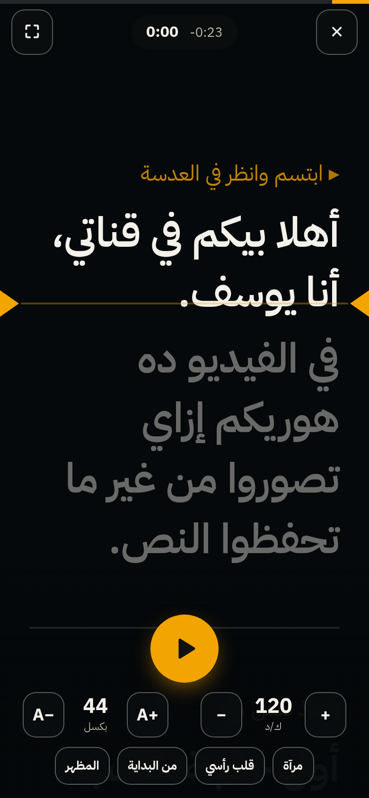
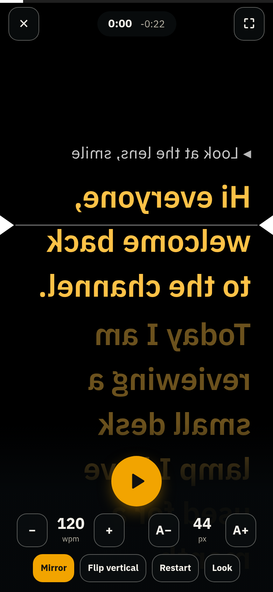
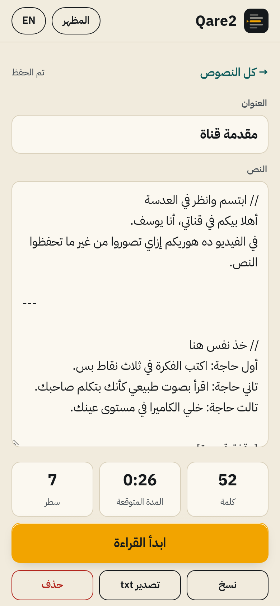
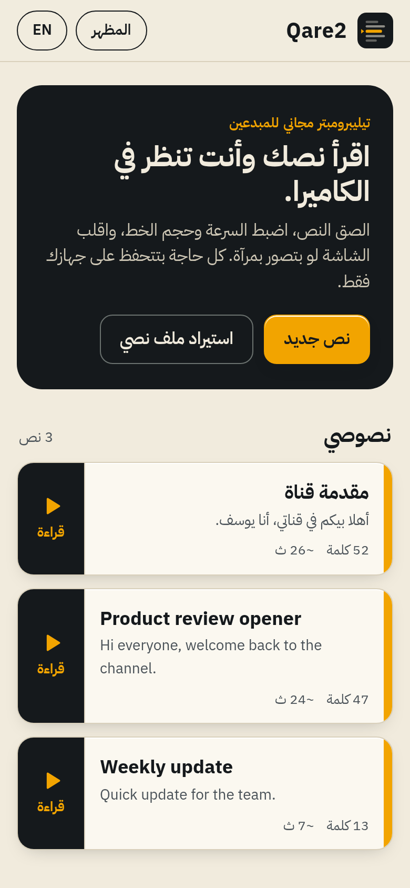
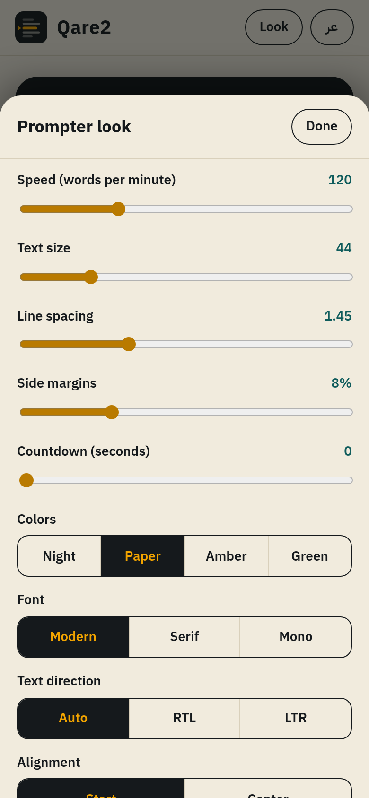

<p align="center"></p>
<h1 align="center">Qare2 | قارئ</h1>
<p align="center">A free teleprompter for content creators. Paste a script, set the speed, mirror it, read Arabic or English.</p>
<p align="center"><a href="https://yousefkhames.github.io/qare2/"><b>Open the live app</b></a></p>

<p align="center">



</p>

## Why

Reading a script while looking at the lens is hard on a phone. Most teleprompter apps are English first, push a subscription, or need an account. Qare2 is a web page: open it, paste, read. Arabic is a first-class language, not an afterthought.

## Features

- Pasted scripts with a library of many scripts, auto-saved in your browser.
- Speed in **words per minute**. The scroll speed is computed from the real text length, so the time left shown on screen is honest.
- Text size, line spacing, side margins, three fonts, four color themes, centered or start-aligned.
- **Mirror** (horizontal) and **flip** (vertical) for beam-splitter rigs.
- Arabic RTL and English LTR. Direction is detected per line, or you can force it. The whole interface switches between Arabic and English.
- Reading line and active-line highlight, progress bar, elapsed and remaining time.
- Cue notes inside the script: `// smile` or `[pause]` show in amber and are not counted as words. `---` draws a divider.
- Countdown before start, tap to pause, drag or wheel to move, keyboard shortcuts (Space, arrows, + and -, M, R, F, Esc).
- Import a `.txt`, export a script, back up and restore everything as JSON.
- Installable and works offline after the first visit (service worker).
- Keeps the screen awake while reading, where the browser supports it.

<p align="center">


</p>

## Keyboard shortcuts

| Key | Action |
| --- | --- |
| Space | Play or pause |
| Up / Down | Faster / slower (5 wpm) |
| + / - | Bigger / smaller text |
| Left / Right | Nudge back / forward |
| PageUp / PageDown | Jump a screen |
| M | Mirror |
| R | Restart |
| F | Fullscreen |
| Esc | Back to the editor |

## Tech

Plain HTML, CSS and JavaScript. No framework, no build step, no server, no tracking, no external requests. Fonts (IBM Plex Sans Arabic, SIL OFL) are bundled. Scripts and settings live in `localStorage`. Core logic is in `lib.js` and is unit tested.

## Run it

Open `index.html` through any static server, for example `npx serve .` or `python3 -m http.server`.

## Tests

```
npm install
npm test
```

- `tests/unit.test.js`: 10 unit tests for parsing, word counts, timing, settings and backups.
- `tests/e2e.js`: a real Chrome click-through (needs Chrome at `/usr/bin/google-chrome`, edit the path if yours differs). It covers language switch, editing and saving, countdown, playback, pause, speed, size, mirror and flip, themes, delete and duplicate, drag and wheel scroll, backup and `.txt` import, offline reload and no horizontal overflow at 320 px. Run it against a deployed copy with `node tests/e2e.js https://yousefkhames.github.io/qare2/`.
- `npm run screenshots` regenerates the images in `docs/` from sample data.

## Honest limits

- GitHub Pages is a demo host. Your scripts are stored per browser and per device. Clearing site data deletes them, so use "Back up everything" now and then.
- There is no sync between devices and no remote control from a second phone.
- It is not a camera app. Run it next to your recording app, or on a second screen or tablet.
- Screen wake lock and fullscreen depend on the browser (Safari on iPhone is limited).
- The time estimate assumes a steady pace. Real scroll time follows your speed setting, not your voice.
- Only tested in Chrome. Other browsers should work but have not been checked.

## License

MIT. See [LICENSE](LICENSE).
